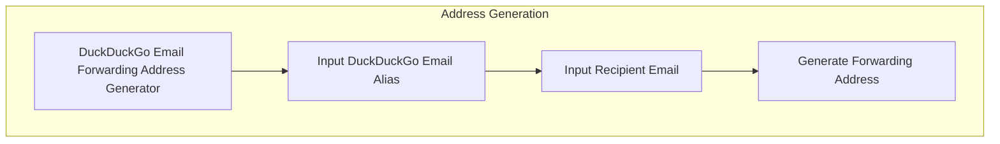
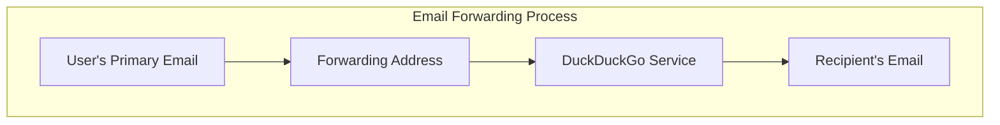

# DuckDuckGo Email Forwarding Address Generator

This Python program generates a special email forwarding address that allows you to send emails from your main account without revealing your real email address to the recipient. Instead, the recipient will see your **DuckDuckGo email alias** as the sender, ensuring your identity remains protected.

---

## ✨ Features
- Generate forwarding addresses using your DuckDuckGo alias.
- Protect your real email identity when sending messages.
- Simple command‑line interface for quick usage.

---

## ⚙️ How It Works
1. Enter your **DuckDuckGo email alias**.
2. Provide the **recipient’s email address**.
3. The program generates a **special forwarding address**.
4. Send your email to this forwarding address from the account you used to sign up for DuckDuckGo Email Protection.

DuckDuckGo will then forward the message to the recipient, showing your alias instead of your real email.

---

## ❓ Why This Project
DuckDuckGo’s extension can only generate new aliases. That means you can only reply anonymously if someone first contacts you using a DuckDuckGo alias.  
This program fills that gap by letting you **initiate anonymous communication** with anyone, using your existing alias.

---

## 📖 Learn More
For details about DuckDuckGo Email Protection, visit the official documentation:  
👉 [DuckDuckGo Email Protection Help Page](https://duckduckgo.com/duckduckgo-help-pages/email-protection/)

---

## 📊 Flowcharts

### Address Generation

### Email Forwarding Process

